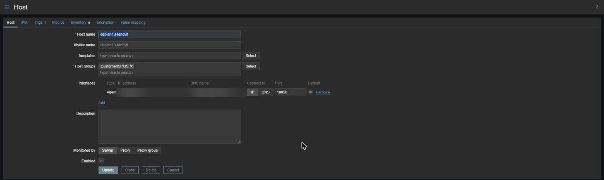
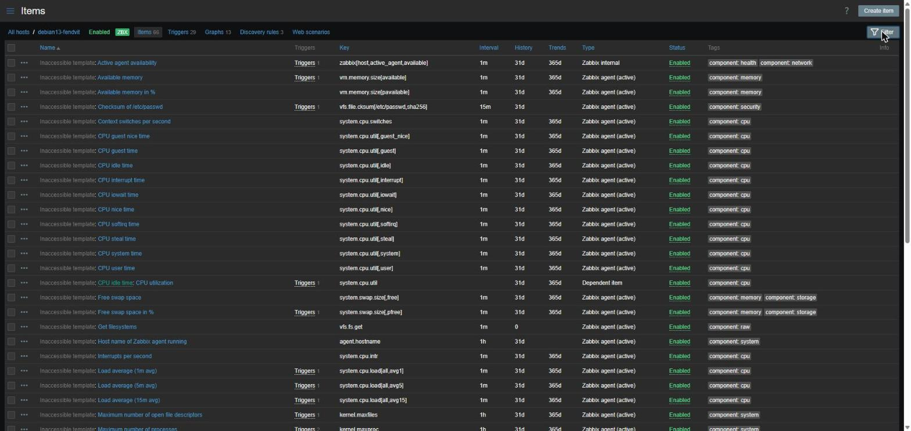
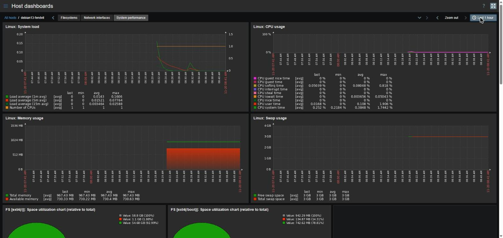

# Zabbix 8.0 auto registrace na Debianu 13


Cílem bylo spustit přes Vagrant Debian 13, nainstalovat na něj Zabbix Agent 2 verze 8.0 a nechat ho, aby se sám zaregistroval na server enceladus.pfsense.cz. Všechno se má udělat samo při `vagrant up`.

## Co je v repozitáři

- `Vagrantfile` - box `bento/debian-13`, 1 CPU a 1 GB RAM, na konci spouští dva skripty
- `install-zabbix-agent2.sh` - přidá oficiální repozitář Zabbix 8.0 pro Debian 13 (ne balíček z Debianu) a nainstaluje agenta
- `configure-zabbix-agent2.sh` - upraví `/etc/zabbix/zabbix_agent2.conf` a restartuje agenta

Vycházel jsem ze skriptů, které jsem dělal 16. 10. pro Zabbix 7.0. Musel jsem změnit odkaz na repozitář (pro 8.0 je v cestě navíc `/release/`) a hlavně hostname. Dřív se generoval přes `uuidgen`, takže po každém `vagrant provision` byl jiný. Teď je pevně nastavený na `debian13-fendvit`, takže zůstane stejný i po restartu.

V konfiguraci agenta se mění tyhle řádky:

```
Hostname=debian13-fendvit
Server=enceladus.pfsense.cz
ServerActive=enceladus.pfsense.cz
HostMetadata=SPOS
```

Podle `HostMetadata=SPOS` server pozná, že má hosta zaregistrovat a dát mu skupinu, štítek a šablonu. Sed v konfiguračním skriptu hledá celý řádek (`^Hostname=.*`), takže když se skript spustí znovu, nic se nezdvojí.

## Spuštění

```console
git clone https://github.com/sposdknl/fendvit-osy-2026-zbx8-auto-reg.git
cd fendvit-osy-2026-zbx8-auto-reg
vagrant up
```

Když chci skripty pustit znovu, stačí `vagrant provision`. Vypnutí je `vagrant halt`.

## Ověření

Ve virtuálce jsem si zkontroloval verzi a jestli agent běží:

```console
vagrant ssh
sudo -i
zabbix_agent2 -V
systemctl status zabbix-agent2
tail /var/log/zabbix/zabbix_agent2.log
```

Verze agenta je `zabbix_agent2 (Zabbix) 8.0.0` a služba je `active`. V logu bylo nejdřív `host [debian13-fendvit] not found` a pár sekund potom `active checks on server are active again`. To znamená, že si server hosta sám vytvořil. Pak jsem pustil ještě jednou `vagrant provision` a `vagrant reload` a hostname zůstal stejný.

## Problémy

Napoprvé spadl instalační skript na posledním řádku. Měl jsem tam `zabbix_agent2 -V | head -1` a se `set -o pipefail` to vrátí chybu, protože `head` zavře rouru dřív, než příkaz dopíše. Agent se přitom nainstaloval normálně. Rouru jsem odstranil a pak už všechno prošlo.

## Výsledek v Zabbixu

Host je zaregistrovaný a má štítek OS: Linux:


Skupina Customer/SPOS (IP adresu jsem rozmazal):



Šablona: můj účet nemá právo šablony vidět, takže pole Templates je prázdné. Že je šablona přiřazená, je vidět na položkách, které jsou z ní zděděné (Inaccessible template):



Data chodí:


Dashboard System performance za poslední hodinu. Grafy začínají kolem 8:20, kdy jsem virtuálku spustil:



## Odkazy

- [Instalace Zabbixu z balíčků](https://www.zabbix.com/documentation/8.0/en/manual/installation/install/packages)
- [Auto registrace aktivního agenta](https://www.zabbix.com/documentation/8.0/en/manual/discovery/auto_registration)
- [Parametry agenta 2](https://www.zabbix.com/documentation/8.0/en/manual/concepts/agent2/agent2_params)
