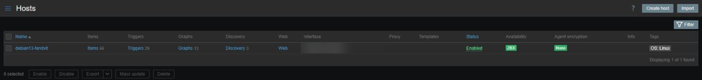
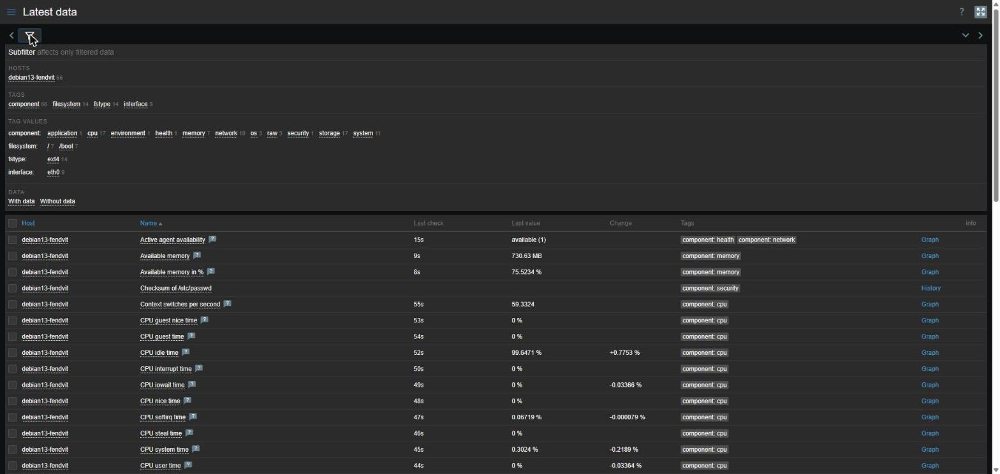

# OSY: Automatická registrace Debianu 13 do Zabbixu


Vagrant spustí virtuální stroj s **Debianem 13**, nainstaluje **Zabbix Agent 2 verze 8.0 LTS** z oficiálního repozitáře Zabbixu a nastaví ho tak, aby se sám zaregistroval na server `enceladus.pfsense.cz`. Všechno proběhne automaticky při `vagrant up`.

## Soubory

| Soubor | Co dělá |
|---|---|
| `Vagrantfile` | Box `bento/debian-13`, 1 CPU, 1 GB RAM, SSH na `127.0.0.1:2206`, spouští oba skripty jako provisionery |
| `install-zabbix-agent2.sh` | Přidá oficiální repozitář Zabbix 8.0 pro Debian 13, nainstaluje `zabbix-agent2`, povolí službu a vypíše verzi |
| `configure-zabbix-agent2.sh` | Nastaví v `/etc/zabbix/zabbix_agent2.conf` `Hostname`, `Server`, `ServerActive` a `HostMetadata`, restartuje agenta |

## Nastavení agenta

```
Hostname=debian13-fendvit
Server=enceladus.pfsense.cz
ServerActive=enceladus.pfsense.cz
HostMetadata=SPOS
```

- **Hostname** je pevný a jedinečný (`debian13-fendvit`), takže je stejný po restartu VM i po opakovaném provisioningu.
- **HostMetadata=SPOS** — podle toho server pozná, že má hosta zaregistrovat, a přiřadí mu skupinu, štítek a šablonu pro Linux (agent 2).
- Registraci spouští **aktivní** spojení agenta (`ServerActive`) na port 10051 serveru.
- Konfigurační skript mění řádky přes `sed` vzory, které sedí na původní i už upravený řádek, takže ho lze spustit opakovaně bez duplicit.

## Spuštění

```console
git clone https://github.com/sposdknl/fendvit-osy-2026-zbx8-auto-reg.git
cd fendvit-osy-2026-zbx8-auto-reg
vagrant up
```

Opakované spuštění skriptů: `vagrant provision`. Vypnutí: `vagrant halt`.

## Ověření

Ve VM (`vagrant ssh`, pak `sudo -i`):

```console
zabbix_agent2 -V
systemctl status zabbix-agent2
grep -E '^(Hostname|Server|ServerActive|HostMetadata)=' /etc/zabbix/zabbix_agent2.conf
journalctl -u zabbix-agent2 --no-pager | tail
```

V Zabbixu na `enceladus.pfsense.cz`: *Data collection → Hosts* → host `debian13-fendvit` (skupina, štítek, šablona) a *Monitoring → Latest data* → přicházející data.

## Výsledek

Ověřeno 20. 11. 2026 (agent `zabbix_agent2 8.0.0`, server Zabbix 7.0.32 na `enceladus.pfsense.cz`). Log agenta po prvním startu:

```
no active checks on server [enceladus.pfsense.cz:10051]: host [debian13-fendvit] not found
active checks on server are active again
```

Server hosta nejdřív neznal, za pár sekund ho auto-registrace vytvořila. Po druhém `vagrant provision` i po restartu (`vagrant reload`) má host stále stejný název a posílá data.

Host `debian13-fendvit` je zaregistrovaný, agent je dostupný (ZBX) a má štítek `OS: Linux`:



Skupina `Customer/SPOS` (IP adresa rozmazaná):


Šablona pro Linux (agent 2, aktivní kontroly): 43 položek je zděděných ze šablony. Žákovský účet nemá právo šablony číst, proto u nich Zabbix píše „Inaccessible template“:


Přicházející data (Latest data):



## Dokumentace

- [Zabbix 8.0: instalace z oficiálních balíčků](https://www.zabbix.com/documentation/8.0/en/manual/installation/install/packages)
- [Zabbix 8.0: automatická registrace aktivního agenta](https://www.zabbix.com/documentation/8.0/en/manual/discovery/auto_registration)
- [Zabbix 8.0: parametry konfigurace agenta 2](https://www.zabbix.com/documentation/8.0/en/manual/concepts/agent2/agent2_params)
